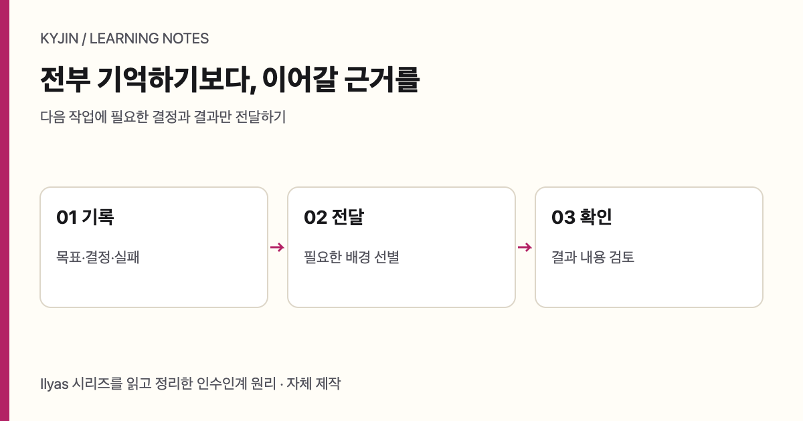

T0 · 작성 요청: GPT-6.1 Terra · 추가 스킬 없음 · <a href="/writing-lab/matrix/?topic=agent-memory-handoff&left=t0&right=s0">다른 조합과 비교</a>

작업을 이어받는 에이전트에게 전체 대화를 붙여 넣으면 안전해 보이지만, 중요한 결정은 오히려 묻힌다. 필요한 것은 모든 문장이 아니라 현재 유효한 결정, 의존성, 담당자, 수용 조건이다. 기록을 보관하는 일과 다음 담당자에게 필요한 맥락을 전달하는 일은 서로 다른 일이다.

<figure class="diagram-card"><figcaption>자체 정리한 인수인계 원리. 기록 보관과 필요한 맥락 전달은 서로 다른 역할이다.</figcaption></figure>

가장 단순한 흐름은 registry에서 현재 결정을 찾고, 필요한 handoff만 선별한 뒤, 의존성 순서에 맞춰 작업하고, 산출물을 검증하는 것이다. architecture·security·reliability 검토는 언제나 모든 작업에 배정하는 고정 의식이 아니라 변경 위험에 맞춰 조건부로 배정한다. 미룬 검증은 없어진 일이 아니라 부채다. 담당자, 재개 조건, 기한을 남기지 않으면 다음 인수인계에서 사라진다.

| 단계 | 남기는 정보 | 다음 담당자가 확인할 것 |
| --- | --- | --- |
| registry | 결정 ID, 상태, 소유자 | active인지 superseded인지 |
| handoff | 목표, 입력, 의존성, 출력 경로 | 지금 필요한 맥락인지 |
| 작업 계약 | 수용 조건, 중단 조건, 검수자 | 무엇이 완료 증거인지 |
| run 기록 | 실행 결과와 실패 | 재현·검토 가능한지 |

이 방식은 모델이 영구 기억을 갖는다는 주장도, 100% 협업이나 생산성 향상을 입증하는 주장도 아니다. 역할 identity와 계약, 실행 기록이 남아 있을 때 새 컨텍스트가 이전 작업을 안전하게 이어갈 가능성을 높이는 운영 설계다. 비용 gate와 품질 gate도 분리한다. 예산 안에 든 작업이 수용 조건을 만족했다는 뜻은 아니다.

## 결제 할인 API 변경을 예로 들어 보기

다음은 실제 구현이나 실험이 아닌 설계 예시다. 결제 할인 API를 바꾼다고 가정하자. pricing code의 owner가 할인 계산 규칙을 책임지고, API 스키마 합의가 프런트엔드 구현보다 먼저 끝나야 한다. 산출물 경로와 수용 조건에는 만료 쿠폰, 중복 요청, idempotency를 넣고 독립 검수자를 둔다. 통화 반올림 문제가 아직 풀리지 않았다면 “나중에 보자”가 아니라 담당자·처리 계기·기한을 기록한다.

| 결정 ID | 상태 | 내용 | 의존성 |
| --- | --- | --- | --- |
| DEC-101 | active | 할인 API 스키마 합의 | 프런트 구현 전 |
| DEC-102 | active | 만료 쿠폰 거절 | 정책 확인 |
| DEC-087 | superseded | 이전 보안 제약 | 새 제약으로 대체 |
| DEBT-014 | pending | 통화 반올림 검토 | 담당자·기한 필요 |

이 registry 표 역시 예시다. 핵심은 active와 superseded를 ID로 구분하는 데 있다. 오래되었다는 이유만으로 보안 제약을 배제하지 않고, active인 결정은 계속 적용하며 명시적으로 superseded된 결정만 새 결정으로 대체한다. handoff에는 “할인 API를 고친다”라는 요약보다, 어떤 결정을 따라야 하는지와 선행 합의가 무엇인지가 더 중요하다.

## 완료 주장을 증거로 바꾸는 절차

파일이 존재하는지, 스키마가 유효한지, 테스트가 통과하는지, 업무 판단이 옳은지는 서로 다른 검사다. 하나가 통과했다고 나머지를 생략하면 안 된다. 예를 들어 출력 파일이 생겼어도 쿠폰 만료 규칙이 틀릴 수 있고, 테스트가 통과해도 중복 요청의 업무 결과가 합의와 다를 수 있다.

| 검사 | 질문 | 실패하면 할 일 |
| --- | --- | --- |
| 존재 검사 | 약속한 출력 경로에 파일이 있는가 | 경로·생성 단계 수정 |
| 구조 검사 | 스키마가 계약과 맞는가 | 타입·필드 수정 |
| 동작 검사 | 수용 사례가 통과하는가 | 구현 또는 사례 수정 |
| 업무 검토 | 정책 의도가 지켜지는가 | owner와 판단 재확인 |

권장 절차는 구체적이다. 먼저 변경 위험을 보고 필요한 독립 검수자를 배정한다. 다음으로 계약의 수용 조건을 사례로 바꾼다. 실패하면 결과를 완료로 표시하지 않고, 실패 종류·수정 책임자·재검사 조건을 run 기록에 남긴다. 수정 뒤에는 같은 수용 증거를 다시 확인한다. 이 흐름은 어떤 도구가 모든 기능을 구현했다는 뜻이 아니다. 특히 rlp-desk가 위 기능을 모두 구현했다고 추정해서도 안 된다.

좋은 handoff는 길이가 아니라 검색 가능성과 판단 가능성으로 측정한다. 다음 담당자가 전체 채팅을 읽지 않고도 유효한 결정, 선행 조건, 위험, 완료 증거를 찾을 수 있어야 한다. 그렇게 남긴 기록은 기억을 대체하는 마법이 아니라, 맥락이 바뀌어도 작업의 책임을 잃지 않는 최소 장치가 된다.

## 무엇을 전달하고 무엇을 남길까

인수인계가 과하면 다음 담당자는 읽기만 하다 멈추고, 너무 짧으면 이미 결정된 일을 다시 논의한다. 그래서 registry에는 장기적으로 찾아야 하는 결정을 남기고, handoff에는 이번 작업에 필요한 발췌만 둔다. 원본 조사 자료나 긴 토론은 링크 가능한 보관물로 남길 수 있지만, 현재의 실행 계약을 대신하지는 않는다.

| 정보 종류 | 둘 위치 | 이유 |
| --- | --- | --- |
| 유효한 정책 결정 | registry | 여러 작업이 같은 판단을 참조 |
| 이번 작업의 입력 | handoff | 새 담당자가 바로 시작 |
| 실행 명령과 결과 | run 기록 | 재현과 실패 분석 |
| 미해결 위험 | debt 항목 | 다음 기회에 사라지지 않음 |

선별 기준도 간단히 적을 수 있다. 다음 결과를 바꿀 정보, 수용 여부를 바꿀 정보, 위험을 높일 정보는 전달한다. 이미 대체된 결정이나 이번 작업과 무관한 실패 이력은 registry에서 검색 가능하게 남기되 handoff 본문에 반복하지 않는다. 이렇게 하면 맥락은 줄지만 책임은 줄지 않는다.

역할 계약도 중요하다. 누가 구현하고 누가 독립 검수하는지, 누가 정책을 최종 판단하는지 명시하지 않으면 “검토됨”이라는 말만 남는다. 독립 검수자는 구현을 다시 쓰는 사람이 아니라, 수용 증거가 계약에 맞는지 확인하는 사람이다. 비용을 확인하는 역할과 품질을 확인하는 역할도 한 사람의 인상으로 합치지 않는다.

작업이 중단될 때의 기록은 완료 기록만큼 중요하다. 어떤 입력이 없었는지, 어떤 의존성이 해결되지 않았는지, 재개하려면 누가 무엇을 결정해야 하는지를 적는다. 단순히 blocked라고 표시하면 다음 담당자는 같은 조사와 같은 위험을 반복한다. 중단 조건까지 계약에 넣으면 멈춤도 검증 가능한 결과가 된다.

## 짧은 handoff의 예

가상의 할인 API 작업이라면 handoff는 “프런트엔드가 API 스키마 합의 뒤에만 시작한다”, “만료·중복·idempotency가 수용 조건이다”, “반올림 부채는 DEBT-014로 owner와 기한을 확인한다”, “독립 검수자가 업무 판단을 확인한다” 정도면 충분하다. 이 네 문장은 긴 대화보다 적지만, 다음 행동을 결정하는 데 필요한 정보는 많다.

이 예시는 시스템 구현을 주장하지 않는다. 다만 기록을 잘 남기는 팀이 무엇을 재사용하는지를 보여 준다. 맥락을 무한히 저장하려 하기보다, 변경될 수 있는 결정의 상태를 드러내고 다음 실행의 증거를 계약으로 묶는 방식이다. 그때 에이전트는 이전 대화를 모두 기억하는 존재가 아니라, 남겨진 책임 있는 기록을 읽고 다음 단계를 수행하는 작업자가 된다.
