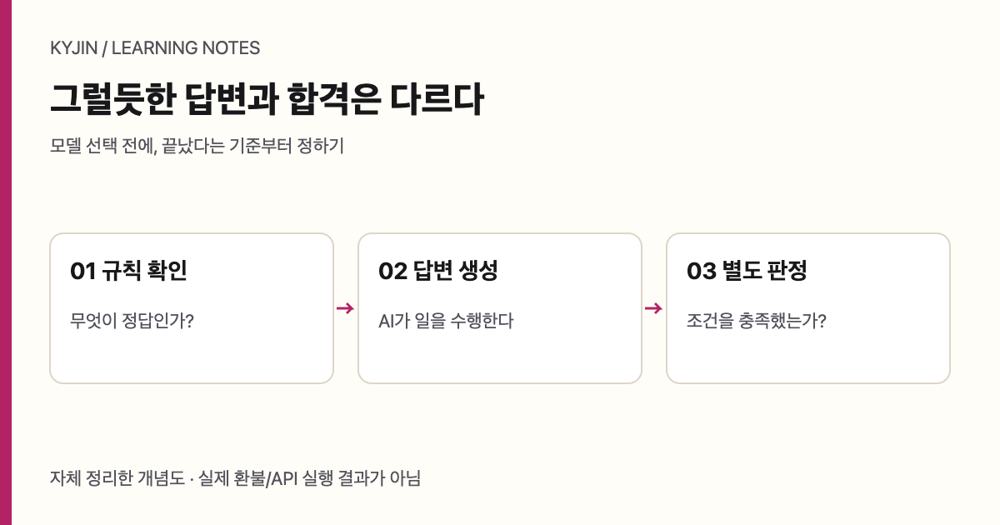

T0 · 작성 요청: GPT-6.1 Terra · 추가 스킬 없음 · <a href="/writing-lab/matrix/?topic=deepseek-model-evaluation&left=t0&right=s0">다른 조합과 비교</a>

에이전트가 환불 가능 여부를 답했다고 해서 환불 규칙을 올바르게 적용한 것은 아니다. 모델은 문맥을 읽고 후보 판단을 만들 수 있지만, 날짜·사용 여부·정책 버전처럼 명확한 조건은 별도 규칙으로 검증해야 한다. 이 분리는 모델을 불신해서가 아니라 오류가 났을 때 어느 단계가 고장 났는지 찾기 위해 필요하다.

<figure class="diagram-card"><figcaption>내가 정리한 평가 흐름. 답변 생성과 합격 판정을 분리한다.</figcaption></figure>

10월 17일 업데이트된 [DeepSeek-V4.1-Flash-1017](https://huggingface.co/deepseek-ai/DeepSeek-V4.1-Flash-1017)에서 API 별칭 `deepseek-flash`는 새 모델을 가리킨다. 그러나 같은 호출 이름이 같은 행동을 보장하지는 않는다. 공급자가 공개한 HF Terminal-Bench 4 수치는 ClaudeCode 31.2에서 42.3으로 11.1퍼센트포인트, DeepSWE 74.2에서 77, Automation 54.8에서 60.5로 변했다. 11.1%라고 쓰면 변화의 단위를 바꾸는 오류가 된다.

별도로 [Vals의 Mini-SWE 평가](https://www.vals.ai/benchmarks/terminal-bench-4)는 10월 29일 갱신되고 10월 30일 확인됐다. 66개 작업 avg@3에서 새 모델은 31.82%, 이전 모델은 19.70%, 테스트당 비용은 각각 $0.54와 $0.50이다. 서로 다른 harness의 수치를 빼서 모델 전체 순위를 만들면 안 된다.

| 평가 | 새 모델 수치 | 비교 대상 | 해석 경계 |
| --- | ---: | ---: | --- |
| 공급자 HF TB4 ClaudeCode | 42.3 | 31.2 | 11.1퍼센트포인트 변화 |
| 공급자 DeepSWE | 77 | 74.2 | 동일 지표 안에서만 비교 |
| Vals Mini-SWE | 31.82% / $0.54 | 19.70% / $0.50 | 66 tasks, avg@3 |

## 환불 데모를 평가 계약으로 바꾸기

원문에 나온 데모는 구매 12일 뒤, 미사용이라는 사례를 사용한다. 정책 조건은 “30일 이내 그리고 미사용”이다. 최대 4회는 모델 호출 횟수이며 도구 호출 4회를 뜻하지 않는다. `get_refund_policy`는 읽기 전용이고 인자를 받지 않는 도구다. 호출 이름이 일치하고 인자가 비어 있는지 확인해야 하며, 구현자가 임의의 파라미터를 만들어서는 안 된다. `eligible` 불리언과 `policy_id`를 확인하고, 실제 정책 조회 여부와 항목 타입을 검증한 다음 애플리케이션의 독립 정책과 대조하는 것이 평가의 핵심이다. 실제 환불 이체는 발생하지 않는다.

저자 Youssef Hosni의 10월 23일 단일 실행은 모델 호출 2회, 2.312초, 입력 855토큰 중 캐시 256, 출력 154토큰이었다. 이는 평균 정확도나 서비스 지연을 입증하지 않으며, 내가 실행한 실험도 아니다. 대신 다음처럼 경계 사례를 제안할 수 있다.

| 가상 사례 | 기대 판정 | 검증 이유 |
| --- | --- | --- |
| 30일, 미사용 | true | 포함 경계 확인 |
| 31일, 미사용 | false | 기간 초과 확인 |
| 12일, 사용함 | false | 독립 조건 확인 |
| 구매일 없음 | 추가 질문 | 판단 전에 필요한 입력 확인 |

이 표는 실제 실행 결과가 아니라 릴리스 전 검사 설계다. 모델이 자연어에서 날짜와 사용 상태를 추출하면, 결정적 정책 검증기가 조건식을 적용한다. 둘의 결과가 다르면 자동 처리하지 않고 중단한다. 실패 원인은 “모델이 틀렸다”가 아니라 입력 누락, 정책 ID 불일치, 조건식 오류, 도구 응답 타입 오류처럼 분해해 기록한다.

## 가격과 긴 문맥을 과장하지 않기

[공식 Agent integrations 안내](https://api-docs.deepseek.com/quick_start/agent_integrations/)와 [가격 안내](https://api-docs.deepseek.com/quick_start/pricing/) 기준 2026년 10월 가격은 1M 토큰당 peak 입력 $0.30·캐시 $0.006·출력 $1.20, off-peak 입력 $0.15·캐시 $0.003·출력 $0.60이다. 중국 공휴일을 제외한 평일 UTC 01–04, 06–10은 peak이고 나머지는 off-peak다.

| 가정 | peak | off-peak | 포함하지 않는 것 |
| --- | ---: | ---: | --- |
| 새 입력 1M + 출력 0.1M | $0.42 | $0.21 | 재시도·별도 도구 비용 |
| 캐시 입력 1M + 출력 0.1M | $0.126 | $0.063 | 캐시 적중 실패 비용 |

긴 context 길이는 많은 규칙을 항상 회수한다는 보장이 아니다. 더 긴 입력은 관련 없는 정책을 섞어 오판을 늘릴 수도 있다. 따라서 릴리스 조건은 모델 점수 하나가 아니라, 정책 조회 성공, 필수 항목의 타입 확인, 경계 사례 통과, 불일치 시 중단이라는 여러 문턱으로 적는다. 모델 평가는 답변의 멋을 평가하는 일이 아니라, 잘못된 답이 업무 동작으로 넘어가지 못하게 설계하는 일이다.

## 평가 결과를 배포 판단으로 연결하기

평가 세트는 실제 업무와 닮아야 하지만, 실제 고객에게 위험을 넘겨서는 안 된다. 그래서 먼저 읽기 전용 조회와 가상 사례로 계약을 검증한다. 환불 가능 여부처럼 결과가 금전 처리로 이어지는 문제에서는 모델이 추천을 하더라도 최종 전송은 결정적 규칙과 별도 승인 단계 뒤에만 가능해야 한다. “도구를 썼다”는 사실과 “올바른 정책을 조회했다”는 사실도 구별해야 한다.

| 관찰 | 통과 증거 | 통과하지 못했을 때 |
| --- | --- | --- |
| 정책 조회 | 예상 policy_id | 해당 정책으로 처리 중단 |
| 입력 해석 | 구매일·사용 여부가 명시됨 | 추가 질문 요청 |
| 규칙 적용 | eligible이 독립 계산과 일치 | 불일치 기록 후 검토 |
| 출력 생성 | 근거와 판정이 분리됨 | 자동 실행 금지 |

이런 계약은 모델의 응답을 채점하기 쉽게 만든다. 예를 들어 구매일이 빠졌는데도 `false`라고 답했다면, 답 자체가 맞을 가능성과 별개로 필요한 정보를 묻지 않았다는 실패를 기록할 수 있다. 반대로 정책상 명확히 거절할 사례에서 추가 질문만 반복한다면, 안전해 보이는 회피가 업무 지연이라는 비용을 만든다. 평가는 정답률 하나가 아니라, 필요한 경우 질문하고 필요한 경우 멈추는 능력까지 포함한다.

릴리스도 단계로 나누는 편이 낫다. 첫 단계는 조회와 설명만 허용한다. 두 번째는 사람이 제안된 판단과 policy_id를 검토한다. 세 번째가 되어도 실제 상태 변경은 애플리케이션의 독립 정책 검사 뒤에 수행한다. 이 설계에서는 모델 별칭이 새 모델을 가리키도록 바뀌었을 때도, 기존 평가 계약을 다시 실행해 동작 변화를 감지할 수 있다. 별칭의 연속성은 검증의 연속성이 아니다.

비용 표 역시 이 과정에 연결한다. peak와 off-peak의 단가 차이는 일정 계획에 쓸 수 있지만, 중요한 정책 변경의 품질 문턱을 낮추는 이유가 되지는 않는다. 저렴한 시간에 대량 평가를 하더라도 재시도와 외부 도구 비용은 별도로 기록한다. 평가가 충분하지 않으면 비용이 낮다는 사실은 위험을 줄이지 못한다.

결국 좋은 모델 평가는 “이번 모델이 몇 점인가”보다 “어떤 종류의 오류가 자동 처리로 넘어가지 않는가”를 답한다. benchmark는 출발 신호로 쓰고, 업무 정책과 경계 사례, 중단 규칙을 갖춘 평가 계약이 배포의 근거가 된다.
