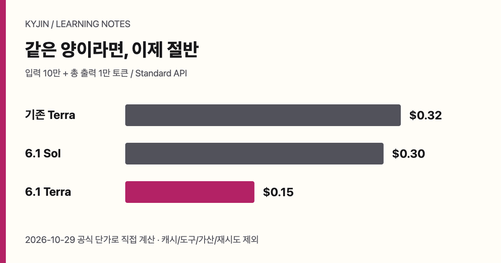

T0 · 작성 요청: GPT-6.1 Terra · 추가 스킬 없음 · <a href="/writing-lab/matrix/?topic=gpt-61-terra-sol-cost&left=t0&right=s0">다른 조합과 비교</a>

모델을 고를 때 흔히 입력 토큰 가격만 보고 “이쪽이 싸다”고 결론 낸다. 그러나 실제로는 한 작업을 끝내는 데 든 비용, 다시 시도한 횟수, 사람이 검토한 시간까지 함께 봐야 한다. 토큰 단가는 출발점이고, 완료 작업 비용은 운영 판단이다. 둘을 같은 숫자로 취급하면 빠르지만 실패가 많은 모델을 과대평가하거나, 비싸 보이지만 재작업을 줄이는 모델을 놓치기 쉽다.

2026년 10월 29일 확인 기준 Standard 요금은 다음과 같다. 단위는 USD/1M 토큰이며 입력·캐시 읽기·출력 순서다. 여기서 캐시는 이미 처리한 입력을 다시 참조할 때의 할인이다. 캐시 할인이 있다고 해서 결과 품질도 할인되거나 같아지는 것은 아니다.

| 모델 | 입력 | 캐시 읽기 | 출력 |
| --- | ---: | ---: | ---: |
| 5.6 Terra | $2 | $0.20 | $12 |
| 6 Sol | $2 | $0.20 | $10 |
| 6.1 Sol | $2 | $0.10 | $10 |
| 6.1 Terra | $1 | $0.05 | $5 |

각 수치는 [5.6 Terra](https://developers.openai.com/api/docs/models/gpt-5.6-terra), [6 Sol](https://developers.openai.com/api/docs/models/gpt-6-sol), [6.1 Sol](https://developers.openai.com/api/docs/models/gpt-6.1-sol), [6.1 Terra](https://developers.openai.com/api/docs/models/gpt-6.1-terra) 문서를 기준으로 한다. 이전 5.6 Terra와 6/6.1 Sol을 교차 세대로 비교하면 가격이 비슷한 항목이 있었지만, 같은 5.6 세대의 Sol과 Terra가 같았다고 일반화하면 안 된다. 새 6.1 Terra는 6.1 Sol의 세 항목 모두 절반이다.

<figure class="diagram-card"><figcaption>직접 계산한 예시. 토큰 수가 같고, 캐시·도구·긴 요청 가산·재시도가 없다고 가정했다.</figcaption></figure>

예를 들어 캐시 없는 입력 10만, 출력 1만 토큰이라는 가정에서는 기존 Terra가 $0.32, 6.1 Sol이 $0.30, 6.1 Terra가 $0.15다. 반대로 9만 토큰이 캐시이고 새 입력과 출력이 각각 1만이면 6.1 Terra는 $0.0645, 6.1 Sol은 $0.129다. 입력 캐시만 할인이므로, 고정된 토큰 수에서 비용이 줄었다는 계산은 품질 동등의 증거가 아니다.

## 벤치마크 숫자가 답이 아닌 까닭

[Vals의 Terminal-Bench 4 Mini-SWE-agent 결과](https://www.vals.ai/benchmarks/terminal-bench-4)는 10월 29일 갱신되고 10월 30일 다시 확인됐다. avg@3, 66개 작업 조건에서 Sol은 55.05%, 테스트당 $1.72, 45분 12초였고 Terra는 49.49%, $2.04, 32분 45초였다. Opus는 65.15%, $13.20, 1시간 4분이었다.

| 모델 | 통과율 | 테스트당 비용 | 시간 |
| --- | ---: | ---: | ---: |
| Sol | 55.05% | $1.72 | 45분 12초 |
| Terra | 49.49% | $2.04 | 32분 45초 |
| Opus | 65.15% | $13.20 | 1시간 4분 |

이 조건에서 Terra는 Sol보다 18.6% 비싸고 5.56퍼센트포인트 낮지만 더 빠르다. 다만 Cost/Test는 통과한 작업 하나를 얻는 비용이 아니다. 같은 harness라도 추론 강도와 토큰 구성이 같았다고 단정할 수 없고, 이 표가 모든 코딩 업무의 순위를 뜻하지도 않는다.

그래서 팀은 “정답을 아는 20개 작업”을 같은 조건으로 돌려 통과 건당 비용을 계산하는 실험을 제안할 수 있다. 이것은 실제 실행 기록이 아니라 비교 설계다. 가령 Terra가 $3로 12건을 통과하면 $0.25, Sol이 $6로 18건을 통과하면 약 $0.333이다. Terra가 8건만 통과하면 $0.375가 된다. 실패와 재시도, 사람 검토 시간은 별도 열로 남겨야 한다.

| 기록할 값 | 왜 필요한가 | 결론에 쓰는 방식 |
| --- | --- | --- |
| 테스트당 비용 | 실행의 평균 지출 | 통과당 비용과 분리 |
| 통과 수 | 실제 완료량 | 실패·재시도와 함께 계산 |
| 검토 시간 | 숨은 운영비 | 자동 비용과 합치지 않고 병기 |
| 작업 종류 | 난이도 차이 | 한 종류의 승리를 일반화하지 않음 |

## 가격 외에 확인할 경계

Opus의 입력·캐시 읽기·출력 단가는 각각 $4·$0.20·$20으로, 세 항목 모두 6.1 Terra의 네 배다. 다만 캐시 쓰기는 5분과 1시간에 따라 $5와 $8로 별도다. [Claude 가격 문서](https://platform.claude.com/docs/en/about-claude/pricing)와 비교할 때도 이 차이를 숨기면 안 된다. OpenAI가 언급한 ALEmax의 9배는 Opus와의 특정 컴퓨터 사용 작업 비용 비교일 뿐이다. 공급자 TB4max가 21.5에서 50.3으로 바뀐 맥락과 최고 난도 코딩에 Sol/Astra를 권장한 맥락도, [6.1 Terra 소개](https://openai.com/ko-KR/index/introducing-gpt-6-1-terra/)의 TBScience 0.1에서 Terra가 낮은 비용으로 Sol보다 높은 점수를 얻었다는 발표와 합쳐 하나의 순위표로 만들 수 없다.

Fast Terra는 Standard의 두 배 단가라 Sol Standard와 같지만, 구독에 포함된 사용량이 정확히 두 배라고 추정해서는 안 된다. [ChatGPT 가격 안내](https://learn.chatgpt.com/docs/pricing)도 API 토큰 과금과 구독 사용 한도를 같은 단위로 약속하지 않는다. 글쓰기 개선 발표 역시 한국어 품질을 보증하지 않는다.

좋은 선택은 가장 싼 모델을 찾는 일이 아니라, 작업군별로 실패 비용을 드러내는 일이다. 짧고 반복되는 변환에는 캐시와 단가가 큰 의미를 가진다. 반면 배포 전 변경처럼 검토가 비싼 일은 통과율, 재시도, 검토 시간을 한 장의 실험 기록으로 보아야 한다. 가격표는 선택의 근거지만, 완료의 증거는 아니다.

## 작은 비교를 운영 기준으로 만드는 법

비교를 시작할 때는 모델 이름보다 작업의 경계를 먼저 고정한다. 예를 들어 버그 수정, 테스트 추가, 문서 변환을 한 표에 넣으면 어느 모델이 어떤 일에서 강했는지 사라진다. 각 작업에는 시작 상태, 허용 도구, 제한 시간, 합격 기준을 적는다. 그 뒤 같은 작업을 여러 모델에 맡겨도 된다. 이때 결과가 한 번뿐이라면 관찰이지 일반적인 성능 증명은 아니다.

| 비교 전 질문 | 기록 예시 | 피해야 할 결론 |
| --- | --- | --- |
| 작업이 무엇인가 | 실패하는 단위 테스트 수정 | 모든 코딩에 더 낫다 |
| 합격은 무엇인가 | 지정된 테스트와 검토 통과 | 답변이 그럴듯하다 |
| 비용에 무엇을 넣는가 | API·재시도·검토 시간 | 호출 가격만 쌌다 |
| 언제 중단하는가 | 세 번째 실패 뒤 사람에게 넘김 | 계속 시도하면 언젠가 된다 |

캐시가 특히 유리한 경우도 분명히 적을 수 있다. 반복해서 같은 코드베이스 설명이나 정책 문서를 넣되, 매번 작은 변경 요청만 달라지는 작업이다. 반면 긴 입력이 매번 달라지거나 출력이 큰 작업에서는 캐시 읽기 가격만으로 비용을 예측하기 어렵다. 도구 호출, 긴 요청 가산, 재시도는 이 단순 계산에서 빠져 있다. 따라서 계산기는 견적의 하한을 주지만, 월간 예산을 보증하지 않는다.

또한 속도는 비용의 반대말이 아니다. Terra가 한 조건에서 더 빨랐다는 관찰은 대기 시간이 중요한 흐름에서 검토할 정보다. 하지만 빠른 첫 시도가 재시도를 늘리면 전체 완료 시간은 길어질 수 있다. 반대로 느린 모델이 첫 제출에서 수용되면 사람의 대기와 수정 요청이 줄 수 있다. 팀이 고르는 대상은 토큰이 아니라 “정의된 수용 조건을 만족한 변화”여야 한다.

마지막으로 공급자의 추천 문구와 독립 평가의 역할을 나눈다. 공급자 발표는 제품이 의도한 용도와 가격을 알려 준다. 독립 benchmark는 정해진 harness에서의 결과를 알려 준다. 내부 비교는 자신의 코드, 검토 규칙, 실패 비용을 알려 준다. 셋 가운데 하나만으로 구매나 배포 결정을 내리기보다, 서로 다른 종류의 증거를 같은 질문에 맞춰 배치하는 편이 안전하다.
